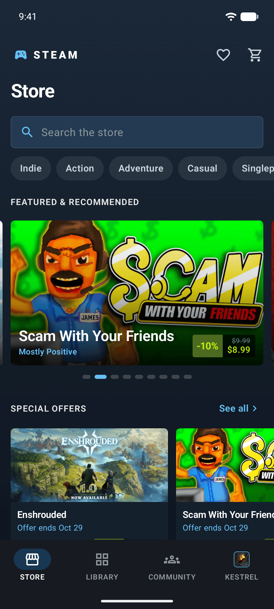
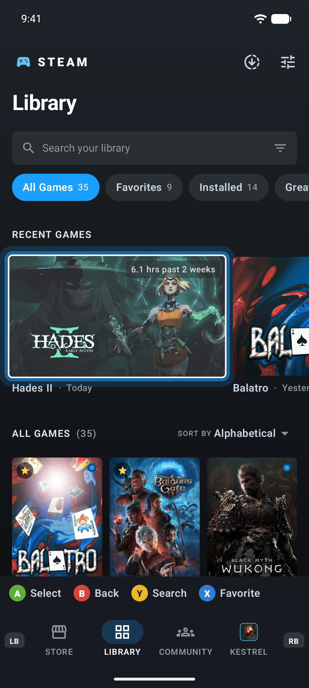
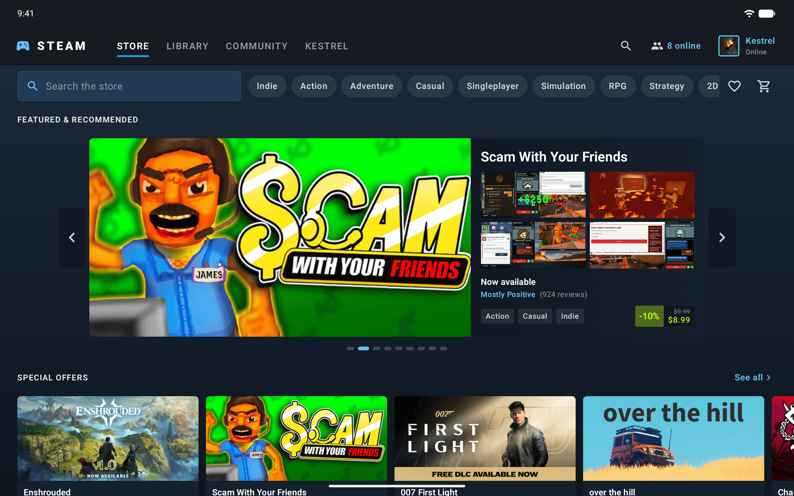

# Native Steam — Android

The Android client of **Native Steam**, an unofficial concept of what a fully native Steam
client could look like: one adaptive UI that works with touch, mouse & keyboard **and** a
gamepad. It renders the shared [`data/snapshot.json`](../../data/snapshot.json) and follows
[`docs/DESIGN.md`](../../docs/DESIGN.md).

> Not affiliated with Valve. No Steam logo is used. Purchase / install buttons are visual only.

| Phone | Gamepad | Tablet |
|---|---|---|
|  |  |  |

## Stack

- Kotlin 2.4, **Jetpack Compose** (BOM 2026.09, UI 1.12) and **Material 3** with a custom dark
  Steam colour scheme, shapes and type (system Roboto + tracked uppercase headers).
- **Navigation Compose** with type-safe routes: every tab owns its own `NavHost` / back stack,
  with predictive-back animations (`enableOnBackInvokedCallback`).
- **Coil 3** (OkHttp) for Steam CDN artwork, with a 25 % memory cache, a 512 MB disk cache and
  name placeholders.
- **kotlinx.serialization** for the snapshot; `data/Model.kt` mirrors
  `core/crates/steam-model` one-to-one.
- `androidx.window` size classes with Steam's breakpoints, edge-to-edge with proper insets.
- Single `:app` module, AGP 9.3 (built-in Kotlin), Gradle 9.8, JDK 17, min SDK 29.

The snapshot is **not copied by hand**: the `bundleSnapshot` Gradle task copies
`../../data/snapshot.json` into a generated assets directory registered through
`androidComponents.onVariants { sources.assets.addGeneratedSourceDirectory(...) }`.

```
app/src/main/java/dev/nativesteam/android/
├── MainActivity.kt          intent extras, input-source tracking, edge-to-edge
├── NativeSteamApp.kt        Coil image loader (memory + disk cache)
├── data/                    Model.kt (serializable mirror of the Rust model), SnapshotRepository.kt
└── ui/
    ├── theme/               brand tokens, gradients, type
    ├── input/               InputState (last input source), FocusedActions, KeyRouter
    ├── components/          steamFocusable, SteamCard, Shelf, PriceBlock, SteamImage, …
    ├── shell/               adaptive shell, top tab row / bottom bar, hints bar, routes
    ├── store/  library/  community/  profile/
```

## Build & run

Requirements: JDK 17 and an Android SDK with platform **37.1** (Compose UI 1.12 needs
compile SDK 37). Create `local.properties` with `sdk.dir=/path/to/Android/sdk` (it is
gitignored), then:

```sh
cd clients/android
./gradlew assembleDebug
adb install -r app/build/outputs/apk/debug/app-debug.apk
adb shell am start -n dev.nativesteam.android/.MainActivity
```

### Launch options (used by the screenshot script)

```sh
adb shell am start -n dev.nativesteam.android/.MainActivity --es tab library      # store|library|community|profile
adb shell am start -n dev.nativesteam.android/.MainActivity --ei game 1145350     # library game page
adb shell am start -n dev.nativesteam.android/.MainActivity --ei app 3470960      # store app page
adb shell am start -n dev.nativesteam.android/.MainActivity --es input gamepad    # hints bar + focus first item
```

`scripts/screenshots.sh [serial]` rebuilds, installs, turns on SystemUI demo mode and re-shoots
every PNG in `docs/screenshots/android/` (phone, then 2560×1600 @ 320 dpi for the tablet shots).

## Adaptive layout

Width buckets follow DESIGN.md §2 and are computed as a custom set of Jetpack
`WindowSizeClass`es (0 / 700 / 1000 / 1100 dp):

| Width | Navigation | Library | Community |
|---|---|---|---|
| < 700 dp (compact) | Material `NavigationBar` with the avatar on the **KESTREL** tab, large collapsing titles | collection chips, 3-column cover grid | segmented `Activity · News · Hubs` |
| ≥ 700 dp (regular) | `bgChrome` top bar: `STEAM` wordmark, uppercase tracked tabs with a 3 dp accent underline, search, friends, avatar | chips + adaptive grid | Activity + News columns |
| ≥ 1000 dp | 〃 | collections **sidebar** with filter field | 〃 |
| ≥ 1100 dp | 〃 | 〃 | Activity · News · **right rail** (friends + hubs) |

## How input works

All three input families are first-class; the UI tracks the **last-used** one.

- **Detection** — `MainActivity` overrides `dispatchKeyEvent`, `dispatchGenericMotionEvent`
  and `dispatchTouchEvent` and classifies each event by its `InputDevice` source
  (`SOURCE_GAMEPAD`/`JOYSTICK` or a gamepad keycode → *gamepad*, `SOURCE_MOUSE`/`TOUCHPAD` →
  *mouse*, `SOURCE_TOUCHSCREEN` → *touch*, everything else → *keyboard*). Controller presence
  comes from `InputManager.InputDeviceListener`.
- **Focus treatment** — every card, row, chip and button uses `Modifier.steamFocusable`: a
  regular Compose focus target (so D-pad / arrow keys get Compose's spatial navigation) that,
  only while the last input is keyboard or gamepad, draws a 2 dp white inner ring, a 4 dp
  accent glow at 55 %, brightens the art and scales to 1.04 with a 120 ms ease-out.
- **Mouse** — hover lifts cards 3 dp and switches card backgrounds to `surfaceHover`;
  covers reveal their name on hover or focus.
- **Touch** — 48 dp targets, ripples and a subtle press scale, snapping shelves
  (`LazyRow` + `rememberSnapFlingBehavior`), swipeable featured pager, pull-to-refresh on
  Community, predictive back.
- **Shelves keep focus in view** — `Shelf` installs a custom `BringIntoViewSpec` that scrolls
  so the focused card stays fully visible with about one card of lookahead.
- **Gamepad buttons** are handled at the shell root in `onPreviewKeyEvent`:

  | Button | Action |
  |---|---|
  | LB / RB | previous / next tab (wraps) and focus its first item |
  | A | activate the focused item (the focused card registers its action in `FocusedActions`) |
  | B | back; at a tab root, focus moves to the tab bar |
  | Y | focus search (Store / Library) |
  | X | favourite (Library) / wishlist (Store), with a confirmation toast |
  | LT / RT | page Library collections / Community sections |

  When nothing inside Compose holds focus, `KeyRouter` routes unconsumed controller keys to the
  same handler, and the first D-pad press lands on the page's first card. With a gamepad as the
  last input, a Big-Picture-style **hints bar** (`Ⓐ Select Ⓑ Back Ⓨ Search Ⓧ Favorite`) sits
  above the tab bar, and `LB` / `RB` glyphs flank the tabs. Focusing a search field with a
  controller does not pop the IME; A or Y does.
- **Keyboard** — arrows move focus, Enter / Space activate, Esc / Backspace go back,
  `Ctrl+1…4` switch tabs, `Ctrl+F` searches, `Ctrl+[` goes back.

Try it on an emulator without a controller:

```sh
adb shell input gamepad keyevent KEYCODE_BUTTON_R1      # next tab
adb shell input gamepad keyevent KEYCODE_DPAD_DOWN      # focus moves into the page
adb shell input gamepad keyevent KEYCODE_BUTTON_A       # open it
adb shell input gamepad keyevent KEYCODE_BUTTON_B       # back
```
