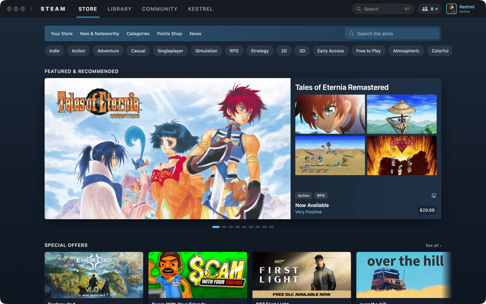
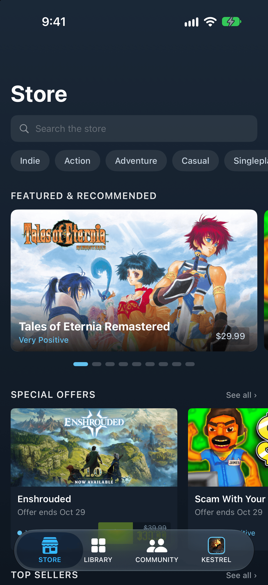
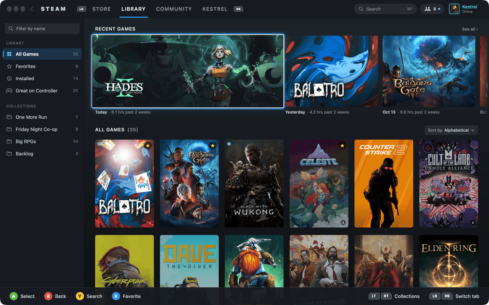
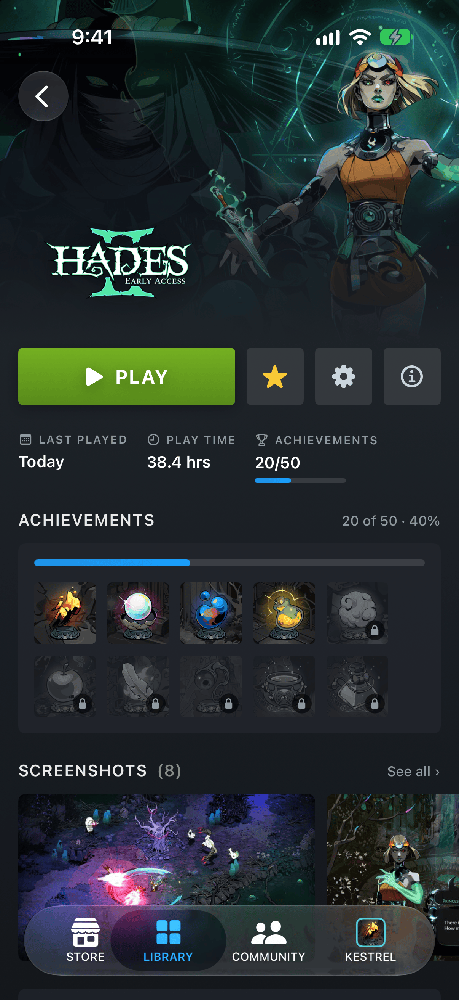

# Native Steam — Apple clients (macOS · iPhone · iPad)

SwiftUI implementation of the Native Steam concept for macOS 26 and iOS/iPadOS 26.
One adaptive UI that works with **mouse & keyboard, touch and gamepad**, rendering the
shared `data/snapshot.json`. See [`docs/DESIGN.md`](../../docs/DESIGN.md) for the spec.

> Unofficial concept. Not affiliated with or endorsed by Valve. No Valve logo is used —
> the app mark is the plain `STEAM` wordmark. Purchase / install buttons are visual only.

| macOS | iPhone |
|---|---|
|  |  |
|  |  |

More in [`docs/screenshots/macos`](../../docs/screenshots/macos) and
[`docs/screenshots/ios`](../../docs/screenshots/ios).

## Structure

```
clients/apple/
├── project.yml                 # XcodeGen spec (source of truth for the project)
├── NativeSteam.xcodeproj       # generated, committed so you can just open it
├── App/
│   ├── macOS/                  # @main for macOS: Window scene, window chrome, ⌘ commands
│   ├── iOS/                    # @main for iOS/iPadOS
│   └── Shared/                 # snapshot loading, asset catalog (app icons)
├── Packages/SteamKit/          # local Swift package — nearly all of the code
│   ├── Sources/SteamKit/
│   │   ├── Model/              # Codable mirror of core/crates/steam-model, lookups
│   │   ├── Design/             # brand tokens, image pipeline, shared components, shelves
│   │   ├── Input/              # FocusEngine, focusable modifier, gamepad + keyboard input
│   │   ├── Shell/              # AppModel, adaptive shell, top nav bar, hints bar, commands
│   │   ├── Store/ Library/ Community/ Profile/   # the four tabs + detail pages
│   └── Tests/SteamKitTests/    # snapshot decoding + spatial focus tests
└── Scripts/                    # screenshot helpers (window-id.swift, screenshot-macos.sh)
```

`data/snapshot.json` is **referenced in place** (`../../data/snapshot.json` in `project.yml`)
and bundled as a resource into both apps — it is never copied into this folder.

## Build & run

Requirements: Xcode 26 or newer (developed with Xcode 27 / Swift 6.4), deployment targets
iOS 26 and macOS 26. [XcodeGen](https://github.com/yonaskolb/XcodeGen) only if you change
`project.yml`.

### Xcode

Open `NativeSteam.xcodeproj`, pick the **NativeSteam-macOS** or **NativeSteam-iOS** scheme
and run. Both schemes have the launch arguments below pre-added (disabled) under
*Edit Scheme › Run › Arguments*.

### Command line

```sh
cd clients/apple

# macOS (ad-hoc signed)
xcodebuild -project NativeSteam.xcodeproj -scheme NativeSteam-macOS \
  -destination 'platform=macOS' -derivedDataPath build CODE_SIGN_IDENTITY=- build
open build/Build/Products/Debug/NativeSteam.app --args -tab library

# iOS simulator
xcrun simctl create "NativeSteam iPhone" com.apple.CoreSimulator.SimDeviceType.iPhone-17-Pro
xcodebuild -project NativeSteam.xcodeproj -scheme NativeSteam-iOS \
  -destination 'platform=iOS Simulator,name=NativeSteam iPhone' -derivedDataPath build build
xcrun simctl install <udid> build/Build/Products/Debug-iphonesimulator/NativeSteam.app
xcrun simctl launch <udid> io.github.nativesteam.ios -tab store

# Unit tests for the shared package (macOS host)
cd Packages/SteamKit && swift test

# After editing project.yml
xcodegen generate
```

CI (`.github/workflows/apple.yml`) runs `swift test` and builds both apps on `macos-latest`
with `CODE_SIGNING_ALLOWED=NO`.

### Launch arguments (screenshot automation)

| Argument | Effect |
|---|---|
| `-tab store\|library\|community\|profile` | Initial tab |
| `-game <appId>` | Open the library game page (e.g. `-game 1145350`, Hades II) |
| `-app <appId>` | Open the store app page |
| `-input gamepad` | Force gamepad mode: hints bar visible, LB/RB glyphs, first item focused |
| `-orientation landscape` | iOS only: request landscape (works on iPhone; iPadOS windowing ignores it) |

On macOS, any of these also pins the window to exactly **1440×900** and disables the
carousel auto-advance so screenshots are deterministic.
`Scripts/screenshot-macos.sh <app> <out.png> <wait> -- <args>` launches the app in the
background, finds its window with `CGWindowListCopyWindowInfo` (`Scripts/window-id.swift`)
and captures it with `screencapture -o -l`.

Set `NATIVE_STEAM_DEBUG_FOCUS=1` to log focus moves and connected controllers to stderr.

## Adaptive shell

* **Compact (< 700 pt)** — native `TabView` with the iOS 26 Liquid Glass tab bar
  (STORE · LIBRARY · COMMUNITY · the persona tab with Kestrel's avatar), a
  `NavigationStack` per tab, native large titles and back gestures, swipe/snap shelves.
* **Regular (≥ 700 pt)** — macOS windows and iPad: a Steam-desktop top nav bar in `bgChrome`
  (`‹ STEAM  STORE  LIBRARY  COMMUNITY  KESTREL … search · friends · avatar`), active tab
  with a 3 pt accent underline. On macOS the window uses a hidden title bar; the traffic
  lights are centred in the nav bar and the bar's background drags the window.
  Library gets a collections sidebar (≥ 1000 pt), Community a right rail (≥ 1100 pt).
* Detail pages: store app page (backdrop, screenshot carousel, info column, purchase box)
  and library game page (hero + logo, PLAY / INSTALL, stats, achievements, friends,
  screenshots, about).

## Input model

The UI tracks the **last-used input** (`FocusEngine.input`) and adapts per DESIGN §3:

| | Pointer | Touch | Keyboard | Gamepad |
|---|---|---|---|---|
| Focus ring | – | – | ✓ | ✓ |
| Hover lift + `surfaceHover` | ✓ (macOS; iPad uses system pointer hover effects) | – | – | – |
| Hints bar | – | – | – | ✓ |

**Spatial focus engine** (`Input/FocusEngine.swift`, `Input/Focusable.swift`)

* Every focusable view uses `.steamFocusable(id:…)`. It reports its window frame through a
  `FocusFramesKey` **preference**; each screen (`.focusScope`) reduces those preferences and
  hands them to the shared `FocusEngine`.
* D-pad / left stick / arrow keys call `engine.move(direction)`, which picks the nearest
  candidate in that direction (items aligned on the other axis win, then distance). Items
  scrolled out of view sideways are only reachable from within their own shelf.
* `.focusScrollContainer` ScrollViews (`ScrollPosition` + `onScrollGeometryChange`) keep the
  focused item visible; horizontal shelves scroll with ~1 card of lookahead.
* The focused view gets the custom ring — 2 pt white inner ring, 4 pt accent @ 55 % outer
  glow — plus scale 1.04 and brighter artwork, animated 120 ms ease-out. It is only drawn
  for keyboard/gamepad input.
* On macOS the engine is mirrored into a root `@FocusState` (`.focusable()` /
  `.focused(_:equals:)`), so Tab / Shift-Tab and VoiceOver stay in sync; `focusSection()`
  groups the nav bar and the library sidebar. Search fields use `@FocusState` on both
  platforms (Y / ⌘F focus them).

**Gamepad** (`GameController` framework, `Input/InputCoordinator.swift`)

| Button | Action |
|---|---|
| LB / RB | previous / next tab (wraps) |
| D-pad / left stick | spatial focus (with key-repeat while held) |
| A | activate |
| B | back; at a root, focus the tab bar |
| Y | search (Store / Library) |
| X | favorite (Library) / wishlist (Store) |
| LT / RT | page Library collections / Community sections |

**Keyboard** — arrows move focus, Return/Space activate, Esc/Delete go back, Tab follows
SwiftUI focus. macOS uses an `NSEvent` local monitor (arrows pass through while a text field
is editing); iPadOS hardware keyboards go through `GCKeyboard`. Menu commands: ⌘1–4 tabs,
⌘[ back, ⌘F search, ⇧⌘[ / ⇧⌘] previous/next tab (also in the iPadOS menu bar).

**Touch** — `Button`s with press feedback, swipe/snap shelves and a paging featured
carousel, ≥ 44 pt targets, native back gestures; a passive window gesture recognizer marks
touch as the last input. iPad pointers get `.hoverEffect(.lift)`.

## Images

`ImagePipeline` loads Steam CDN artwork with a dedicated `URLSession` backed by a 1 GB
`URLCache` (disk) plus an `NSCache` of decoded, downsampled bitmaps (ImageIO, decoded off
the main actor). Placeholders are `surface`-coloured and can show the game name.
