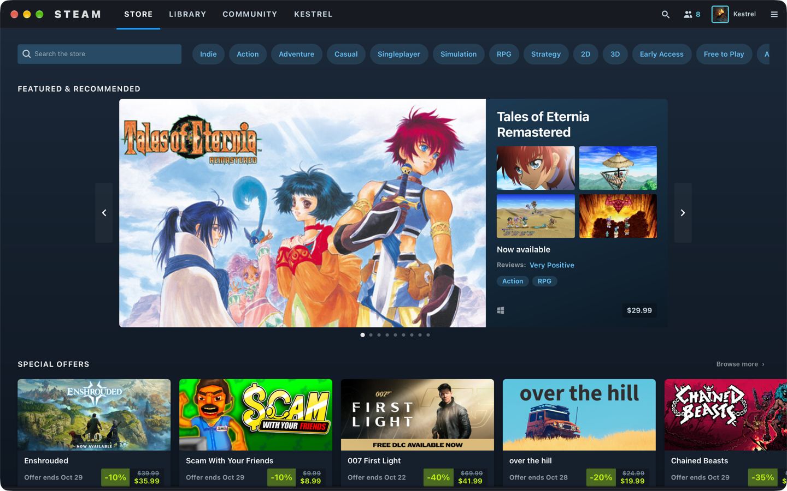
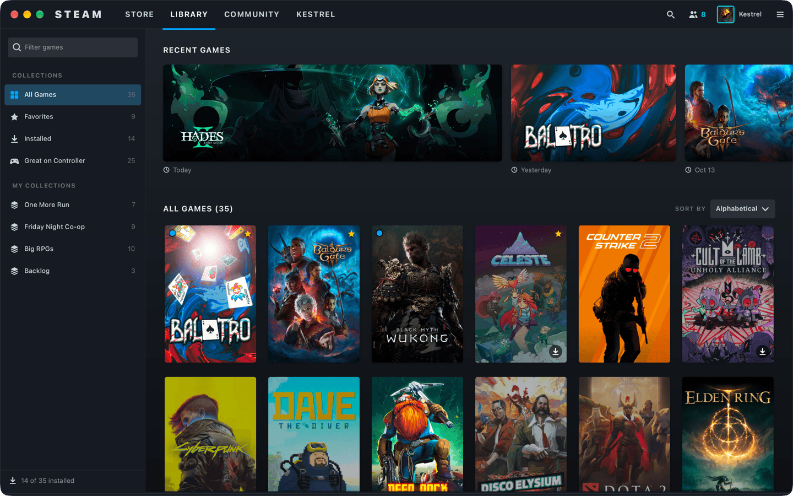
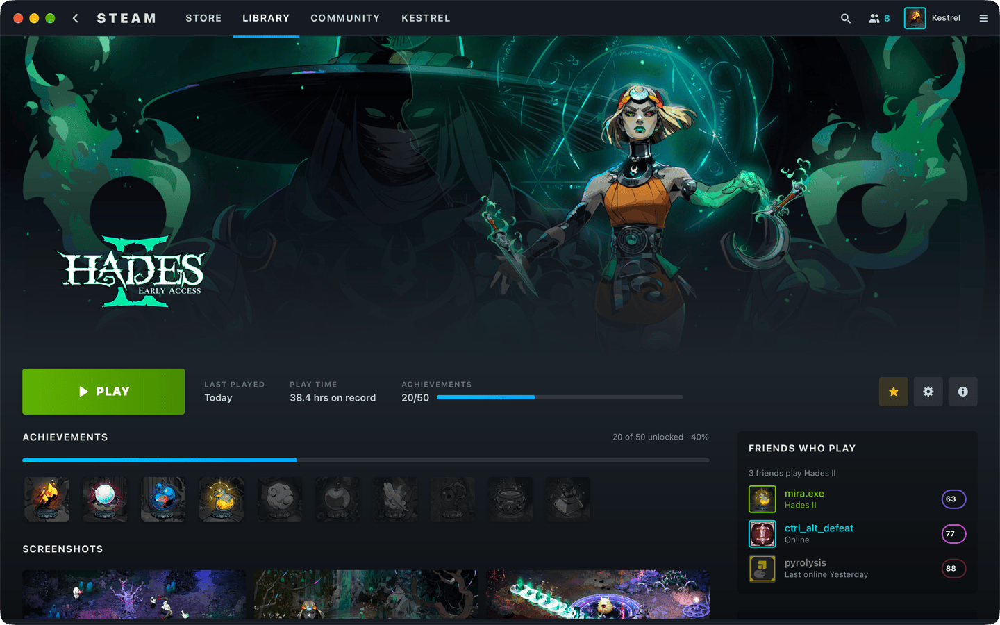
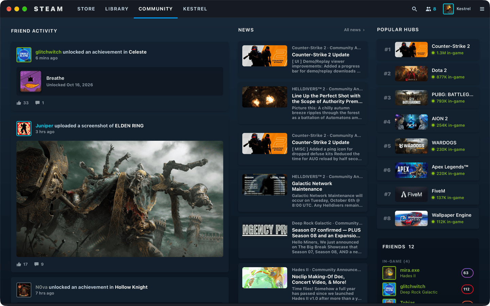
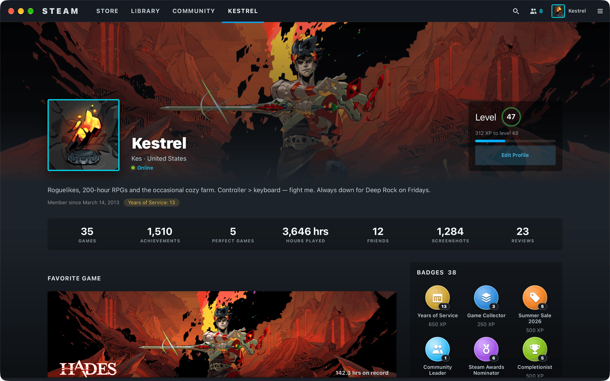
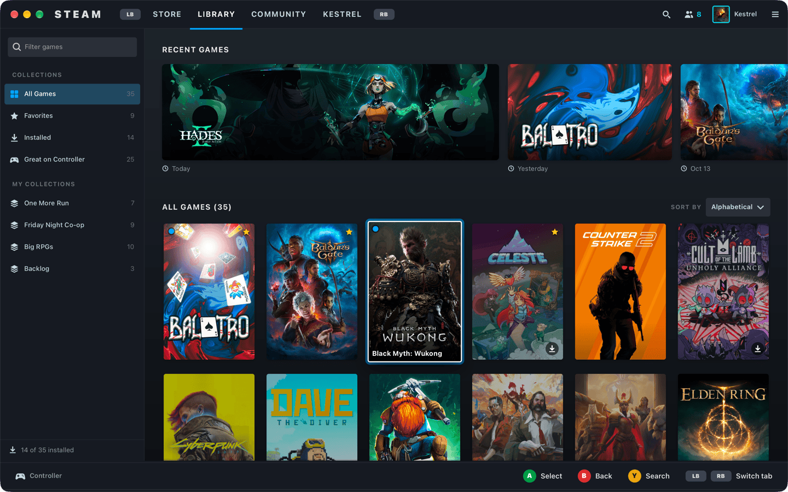
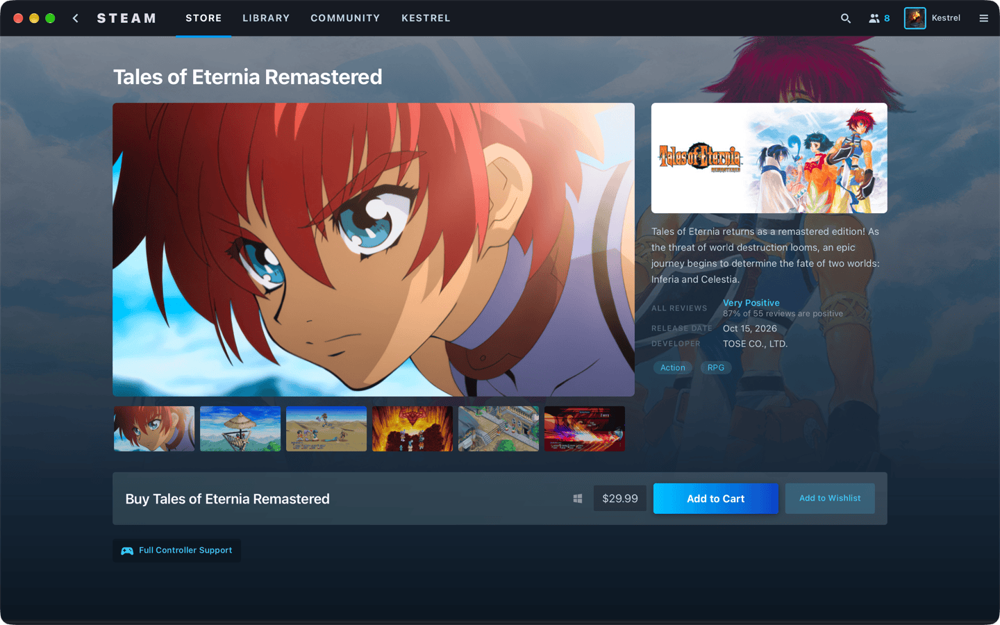
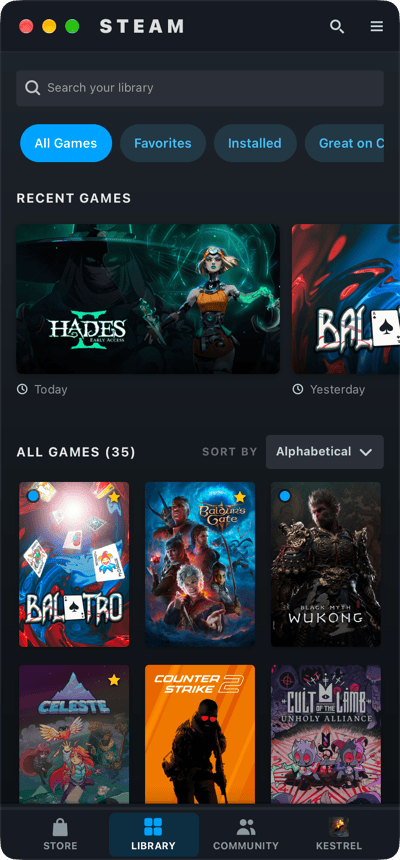

# Native Steam — Linux (GTK 4 + libadwaita, Rust)

The Linux client of [Native Steam](../../README.md), an unofficial concept of a
fully native Steam client. It has one adaptive UI that works with mouse and
keyboard, touch and gamepad. It is not affiliated with Valve: no Valve logos are
used, and purchases and installs are purely visual.



| | |
|---|---|
|  |  |
|  |  |
|  |  |



> [!NOTE]
> The screenshots were captured on macOS using **GTK's macOS backend**, so the
> window has macOS traffic-light controls and the system font is SF Pro. On a
> Linux desktop the same build gets libadwaita window controls and Cantarell or
> Adwaita Sans.

## Why GTK 4 + libadwaita, in Rust

- **It's the native toolkit** for GNOME and the most native choice for
  Linux generally, including Steam Deck desktop mode. The app follows the GNOME
  HIG where it can: header bar, `AdwNavigationView` push/pop with swipe-back,
  toasts, `AdwAboutDialog` and adaptive layouts.
- **Adaptive by design.** `AdwBreakpoint`s switch between a Steam-style top tab
  strip and an `AdwViewSwitcherBar` at the bottom. Width-dependent layouts
  re-flow from the same breakpoints. GTK gestures handle touch, kinetic
  scrolling and swipes.
- **Rust uses the shared core directly.** The other clients decode the JSON
  that the core produces. This client links
  [`core/crates/steam-model`](../../core/crates/steam-model) itself and calls
  `Snapshot::from_json`, so the data model is compiled into the app.

## What's inside

| Area | What it does |
|---|---|
| **Store** | Search field and tag chips; *Featured & Recommended* carousel (capsule plus a details panel with 2×2 screenshots, auto-advances every 6 s, pauses on hover or focus, arrows and dots); *Special Offers*, *New & Trending* and *Popular Upcoming* shelves; *Top Sellers* as two-column rows (a shelf on compact); a ranked *Most Played* chart with a live dot. |
| **Store app page** | Page background art faded into the store gradient, a screenshot carousel with thumbnails, description, review summary, facts, genres, a purchase box (price block with Add to Cart / Wishlist, or *Play Now* when the game is owned) and a controller-support badge. |
| **Library** | Collections sidebar with a filter field at ≥ 1000 px (chips below that); *Recent Games* as hero cards with logos (the first is double-width); a portrait grid with live filter, collection and sort (A–Z, recent, hours). Not-installed games are dimmed and show a download glyph; favorites get a star and pending updates a blue dot. Hovering or focusing a cover shows its name. |
| **Game page** | Full-bleed hero with the logo, a gradient into the page, PLAY or INSTALL (with size), star/settings/info buttons, stats (last played, play time, achievements with progress), an achievement strip (locked ones are desaturated), friends who play, screenshots, and About. |
| **Community** | Friend activity cards (achievement, screenshot, review, now playing, new game); News; Popular Hubs and Friends in a right rail at ≥ 1100 px; a segmented *Activity / News / Hubs* switcher on compact. |
| **KESTREL** | Banner with avatar, level ring and XP, summary, a 7-stat row, favorite game, recent activity, the rare-achievement and screenshot showcases, badges as medallions, and friends. |

Every `*Label` field is rendered as-is from `data/snapshot.json`, and optional
fields fall back gracefully: missing logos become text, missing hero art falls
back to the capsule, a missing price shows "Coming soon", and so on.

## Input model

All three input methods are first-class (see [DESIGN.md §3](../../docs/DESIGN.md)).
The app tracks the **last-used input**: a window-level `GtkEventControllerLegacy`
watches clicks, touches and key presses, and gamepad events come from `gilrs`.

| | Mouse & keyboard | Touch | Gamepad |
|---|---|---|---|
| Focus ring | keyboard only (GTK `:focus-visible`) | hidden | always visible |
| Hover | lift + `surfaceHover` | off | n/a |
| Hints bar | hidden | hidden | **shown** (`GtkRevealer` at the bottom) |

**Focus treatment.** The focused card scales to 1.04 using a CSS `transform`
with a 120 ms ease-out. It gets a 2 px white ring (CSS `outline`, which GTK
draws above the artwork), a 4 px accent glow and slightly brighter artwork
(`filter: brightness()`).

**Spatial navigation.** Arrow keys and the D-pad / left stick use the same
algorithm. It collects every focusable, mapped widget in the window, compares
window-space bounds and picks the nearest one in the requested direction,
penalising off-axis distance. This works across nested scrollers (shelves
inside pages), carousels and the header. The focused item is scrolled into view
with an `AdwTimedAnimation`: shelves keep about one card of lookahead, and
pages keep the section header above the focused row visible. When a page is
pushed, focus lands on its primary action (for example PLAY). Going back
returns focus to the card that opened it.

**Gamepad** (via [`gilrs`](https://crates.io/crates/gilrs), polled every 16 ms
with `glib::timeout_add_local` on the main loop; held directions repeat):

| Button | Action |
|---|---|
| D-pad / left stick | move focus |
| A | activate |
| B | back (pop navigation; at a root page, focus the tab bar) |
| Y | focus search (Store / Library) |
| X | favorite (Library) / wishlist (Store) |
| LB / RB | previous / next tab (wraps) |
| LT / RT | previous / next Library collection or Community section |

**Keyboard:** `Ctrl+1…4` switch tabs, `Ctrl+F` searches, and `Esc`,
`Backspace`, `Ctrl+[` or `Alt+←` go back. Tab follows GTK's normal order.
**Touch:** large targets (whole cards are buttons), kinetic shelves, swipe-back on
navigation pages and swipe paging in the carousels.

## Build & run

You need Rust ≥ 1.92 ([rustup](https://rustup.rs)), GTK ≥ 4.14, libadwaita
≥ 1.5 and udev headers (gilrs uses them for gamepads on Linux).

**Ubuntu 24.04+ / Debian 13+**
```sh
sudo apt install build-essential pkg-config libgtk-4-dev libadwaita-1-dev libudev-dev
```
**Fedora 40+**
```sh
sudo dnf install gcc pkgconf-pkg-config gtk4-devel libadwaita-devel systemd-devel
```
**Arch Linux / SteamOS (desktop mode, dev setup)**
```sh
sudo pacman -S --needed base-devel gtk4 libadwaita systemd-libs
```
**openSUSE Tumbleweed**
```sh
sudo zypper install gcc pkgconf gtk4-devel libadwaita-devel libudev-devel
```
**macOS** (development only; this is how the screenshots were made)
```sh
brew install gtk4 libadwaita pkgconf
```

Then, from this directory:
```sh
cargo run --release
```

Artwork is fetched from Steam's public CDN on first use and cached in memory
and under `~/.cache/native-steam/images` (`~/Library/Caches/...` on macOS).

### Command-line flags

Useful for screenshots and testing:

```
--tab <store|library|community|profile>   start on this tab
--game <appId>                            open the library game page (e.g. 1145350)
--app <appId>                             open the store app page
--input gamepad                           start in gamepad mode (hints bar, first item focused)
--size 1440x900                           initial window size
--nav d,r,a                               scripted gamepad presses after startup (u d l r a b x y lb rb lt rt)
--ignore-pointer                          ignore the mouse so a parked cursor can't hover anything
--snapshot <path>                         load another snapshot.json (default: bundled)
```

For example, the screenshots in `docs/screenshots/linux/` were taken with:

```sh
native-steam --tab store
native-steam --game 1145350
native-steam --tab library --input gamepad --nav d,r
native-steam --tab library --size 400x860
```

### Flatpak

[`flatpak/io.github.swsvindland.NativeSteam.json`](flatpak/io.github.swsvindland.NativeSteam.json)
builds against the GNOME 48 runtime:

```sh
flatpak-builder --user --install --force-clean build-flatpak flatpak/io.github.swsvindland.NativeSteam.json
flatpak run io.github.swsvindland.NativeSteam
```

It lets cargo use the network during the build, which is fine locally. Flathub
would need vendored crates via `flatpak-cargo-generator`. `--device=all` gives
gilrs access to gamepads.

### Gamepads on Linux

gilrs reads `/dev/input/event*`. Most distros give the logged-in user access
to game controllers through udev `uaccess` rules. If a pad isn't detected,
install your distro's `steam-devices` / `game-devices-udev` package.

## Project layout

```
Cargo.toml           standalone crate; depends on ../../core/crates/steam-model
build.rs             compiles data/ into a GResource (needs glib-compile-resources)
data/style.css       Steam tokens over libadwaita; auto-loaded by AdwApplication
data/style-adw15.css libadwaita 1.5 palette overrides (@define-color)
data/style-adw16.css libadwaita ≥ 1.6 palette overrides (CSS variables)
data/icons/          bundled symbolic icons (no dependency on an icon theme) + app icon
src/main.rs          app setup, snapshot loading (embedded with include_str!)
src/shell.rs         window, header tab strip, view stack, navigation, breakpoints
src/responsive.rs    width classes (compact / medium / large / wide) + re-flow hooks
src/input.rs         input-mode tracking, spatial navigation, gilrs, hints bar
src/images.rs        async loader: worker threads + ureq + disk/memory cache
src/art.rs           `Art` widget: aspect-ratio artwork, lazy load on map, fade-in
src/ui.rs            shared components: tiles, shelves, price block, chips, avatars
src/store.rs  src/library.rs  src/community.rs  src/profile.rs
```

**Compatibility.** The crate enables gtk4-rs `v4_14` and libadwaita-rs
`v1_5` (the Ubuntu 24.04 LTS / GNOME 46 baseline) and uses no newer APIs. GTK
4.20+ changed `GtkBox`'s height-for-width algorithm, so multi-column layouts
use `GtkGrid` and stay warning-free on both old and new GTK.

**Images.** `Art` requests its URL the first time it's mapped. Eight worker
threads check the disk cache, fetch with `ureq` (rustls) and decode with
`gdk_texture_new_from_bytes`, which is documented as thread-safe. The texture
then goes back to the main loop over an `async-channel`. Requests are
deduplicated per URL. A `surface`-coloured placeholder (optionally showing the
game's name) stays up until the image fades in.
