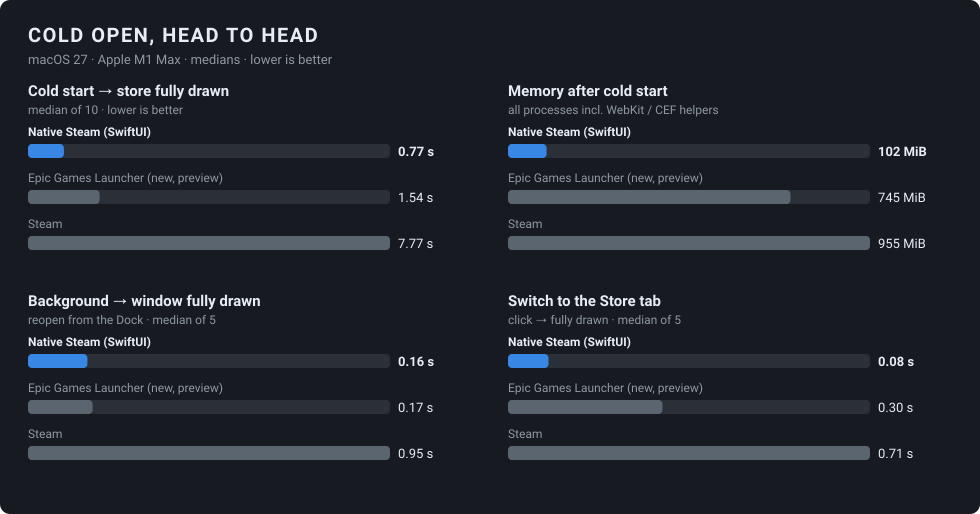

# Benchmarks

On **October 14, 2026** Epic previewed its rebuilt Epic Games Launcher. It
claims a **5.47 s cold start versus 10.07 s for Steam (1.8× faster)**, a Store
that opens **3× faster than Steam** and a Library that loads **30× faster**.
The figures come from Epic's
[preview site](https://launcher.epicgames.com/), from testing by Keywords
Studios commissioned by Epic: an average of 5 tests on each of 13 machines,
excluding the 3 lowest-end.

This page measures the same things on one machine, with one black-box harness,
for all three: **Native Steam**, **Steam** and **Epic's new launcher**.

## Results: macOS

MacBook Pro (M1 Max, 32 GB), macOS 27.0.1. Medians; p90 in small type.

| Cold start | Window shown | First content | **Store fully drawn** | Memory | Processes |
|---|---:|---:|---:|---:|---:|
| **Native Steam** (SwiftUI) | **0.57 s** | **0.66 s** | **0.77 s** p90 0.83 s | **102 MiB** | 2 |
| Epic Games Launcher (new, preview) | 0.88 s | 1.49 s | 1.54 s p90 1.90 s | 745 MiB | 10 |
| Steam | 4.99 s | 7.51 s | 7.77 s p90 8.20 s | 955 MiB | 11 |

| After launch | Background → window | Background → fully drawn | Open Library tab | Open Store tab |
|---|---:|---:|---:|---:|
| **Native Steam** | 0.12 s | **0.16 s** | 0.09 s | **0.08 s** |
| Epic Games Launcher | **0.06 s** | 0.17 s | 0.17 s | 0.30 s |
| Steam | 0.10 s | 0.95 s | **0.08 s** | 0.71 s |

**In short:**
- **Cold start:** Native Steam is fully drawn in **0.77 s**: **2× faster than Epic's new launcher** and **10× faster than Steam**.
- **Memory:** it uses **7× less than Epic** and **9× less than Steam**.
- **Store tab:** it opens **3.7× faster than Epic** and **9× faster than Steam**.
- **Library tab:** Native Steam and Steam tie (both instant).
- **Reopen from the background:** Native Steam and Epic tie.

Epic's own claims mostly hold up on this machine. Its new launcher really is
much faster than Steam: **5× at cold start** here, more than the 1.8× Epic
advertises (Epic's figure averages Windows PCs; this is one Mac), and **2.4× to
open the Store** (Epic claims 3×). Epic's "Library 30× faster" didn't reproduce as a tab
switch: Steam's Library tab is already instant. Epic most likely means loading
a large library.

One of the ten Steam cold starts took 19.6 s. It's kept in the data (the
median absorbs it); a real user would have waited for it too.

## Results: web store front

The Native Steam web client's static store page (`/store/`, real store data,
artwork from Steam's CDN), served locally, against the live
store.steampowered.com. Lighthouse 13.5 with simulated throttling, which
models the network from what each page downloads. A local server still answers
faster than Steam's, so treat first-paint as favouring us; page weight,
JavaScript and blocking time aren't affected. Median of 3.

| | Lighthouse | First paint | Largest paint | Speed Index | Blocking | Page weight | JavaScript |
|---|---:|---:|---:|---:|---:|---:|---:|
| **Native Steam** (desktop) | **87** | **0.48 s** | **2.43 s** | **0.48 s** | **0 ms** | **4.9 MB** | **0.54 MB** |
| store.steampowered.com (desktop) | 78 | 0.91 s | 2.77 s | 2.66 s | 51 ms | 14.8 MB | 2.95 MB |
| **Native Steam** (mobile) | **73** | **2.25 s** | **12.1 s** | **2.25 s** | **64 ms** | **5.0 MB** | **0.54 MB** |
| store.steampowered.com (mobile) | 43 | 3.68 s | 14.6 s | 11.1 s | 630 ms | 13.1 MB | 2.95 MB |

store.epicgames.com served headless Chrome a bot-protection challenge, so it's
reported as blocked rather than measured. Getting past it would mean defeating
bot detection, which this project doesn't do.

Re-run it with `pnpm build && pnpm serve` in `clients/web`, then
`node bench/web/lighthouse.mjs 3 --preset desktop` (or `--preset mobile`).

## What's being compared

| | Native Steam | Steam | Epic Games Launcher |
|---|---|---|---|
| Version | this repo | client build 1791918634 (Oct 13, 2026 update) | 0.96.1 preview ("EGLv2") |
| Built with | SwiftUI (native) | Chromium Embedded Framework | [Tauri](https://tauri.app) (Rust + system WebKit) |
| Lands on | Store | Store | Store |
| Store data | bundled snapshot of the real store | live | live |
| Signed in | (fake user) | yes | yes |
| Install size | 11 MB | 1.2 GB | 165 MB |

Machine: MacBook Pro, Apple M1 Max, 32 GB, macOS 27.0.1, plugged in, on Wi-Fi.

## Method

All three apps are measured by [`bench/macos/launchbench`](../bench/macos/launchbench.swift),
which treats every app as a black box. It needs no hooks in the app.

- **Cold start:** all of the app's processes are fully quit and the system idles
  for 3 s. Then the app is launched the way Finder or the Dock would launch it
  (`NSWorkspace.openApplication`).
  - "Cold" means a cold *app*, not a cold *disk*: macOS's file cache isn't purged
    (that needs root). This is the same for all three apps.
  - Each app's own caches (Steam's and Epic's web caches, Native Steam's image
    cache) are warm, as they would be for a returning user.
- **Recording:** a 60 fps ScreenCaptureKit recording of the display starts
  *before* the launch.
  - It filters out every other app and the desktop picture, so the app under
    test is recorded alone, on black.
  - Each frame is cropped to the app's main window and diffed against the
    previous frame.
- **Three timings, all from the moment of launch:**
  - **Window shown:** the main window (≥ 700×450) appears on screen.
  - **First content:** the window first shows real content, not a flat splash
    screen or a spinner (judged by contrast).
  - **Visually complete:** the last change touching ≥ 6% of the window, before
    it holds still for 2.5 s. Small perpetual animations, such as Epic's friends
    list or Steam's spinner, are ignored. Hero carousels advance much later than
    2.5 s, so they don't count.
- **Memory:** taken 6 s after the window settles. It's the summed physical
  footprint (`footprint`) of every process belonging to the app, *plus* every
  process macOS attributes to it, as Activity Monitor does. Without that, a
  WebView-based app's WebKit helpers would go uncounted.
- **Background → window:** the window is closed with its close button (the app
  keeps running in the background, as all three do), then reopened the way a
  Dock click does it.
- **Tab switches:** the harness reads the window with OCR to find the
  `Library` and `Store` labels, clicks them alternately, and times from
  mouse-up to visually complete.
- **Runs:** 10 cold starts, 5 reopens and 5 of each tab switch per app.
  Medians are reported, with p90 alongside. Raw per-run data is in
  [`bench/results`](../bench/results).

Re-run it with `bench/macos/run.sh`. It needs Screen Recording and
Accessibility permission, and Steam and Epic installed and signed in.

## Caveats, honestly

- **Native Steam doesn't sign in or fetch store data at launch.** It renders a
  bundled snapshot of the real store, built by `steam-snapshot`. Steam and Epic
  authenticate and fetch their store live.
  - Native Steam's artwork does stream from Steam's CDN, the same as Steam's own.
  - Fetching the store's shelf data live (`featuredcategories`) takes a median
    **0.23 s** from this machine. Even with that on the critical path, Native
    Steam would be fully drawn at about **1.0 s**, still ahead of Epic's 1.54 s.
    That's an estimate, not a measurement.
- **Epic's launcher is a preview** that Epic describes as "light on features".
  Steam carries a decade of features.
- **Different window sizes:** Native Steam opens at 1440×900. Steam and Epic
  reopen at the size you last left them: about 1260×790 and 1280×720 here.
  The larger window is a slight handicap for us.
- **Native Steam was tuned after the first round of measurements.** Iterating
  against a stopwatch is what the harness is for. See
  [what changed](#what-we-changed-after-the-first-run).

## What we changed after the first run

The first run showed that Native Steam already won cold start and memory, but
**lost to Epic on tab switching and on reopening from the background**. The
fixes were all ordinary native-app hygiene:

- **Tabs stay alive after their first visit.** Switching back is a visibility
  flip, not a rebuild with a crossfade. Hidden tabs hand their focus targets
  back to the gamepad/keyboard focus engine, so focus never lands on an
  invisible card. Store tab: about 0.25 s in the first run → **0.08 s**. The
  first run used an earlier harness, so part of that gap is measurement.
- **Closing the window hides it** (as Steam and Epic do), and a Dock click shows
  it again with its view tree, scroll position and decoded art intact.
- **The window shows without the zoom-in animation** when launched or brought
  back. The content is already drawn, so the animation was pure waiting.
- **Store shelves are lazy.** Only on-screen cards, plus the focus look-ahead
  card, are built at launch. That cut about 60 ms of SwiftUI layout from cold
  start (found with a Time Profiler trace).
- **Disk-cached artwork appears without a fade.** Fades are kept for images that
  actually kept you waiting on the network.
- **Web:** the hero image loads at `fetchpriority="high"`. Desktop largest
  paint went from 2.81 s to **2.43 s**.

The harness also improved along the way, which made the comparison *fairer*,
not friendlier:
- The first version took a screenshot of each window. It couldn't see the
  first ~150 ms after a window appeared, and it saw other apps' windows behind
  a fading-in window.
- The final version records the display continuously from before launch, with
  everything but the app under test filtered out.

## Other platforms

There's no Steam or Epic launcher to race on these. Steam's Android app is a
companion app, and there's no CI runner with a signed-in Steam or Epic. So
these are Native Steam's own numbers, as a reference.

| Platform | Measured with | Cold start | Memory |
|---|---|---:|---:|
| **Android**, Jetpack Compose (release build, R8) | `am start -W` TotalTime: process start → first frame, 10 runs. Pixel emulator (Android 16, arm64) on the M1 Max | **0.15 s** p90 0.18 s | 63 MiB PSS |
| **Windows**, WinUI 3 (Release, self-contained) | Process start → main window visible, 10 runs on a GitHub Actions `windows-latest` VM (2 vCPUs, no GPU, Windows Server 2025) | **0.91 s** p90 1.67 s | 107 MiB private · 232 MiB working set |

Scripts: [`clients/android/scripts/coldstart.sh`](../clients/android/scripts/coldstart.sh)
and [`clients/windows/scripts/coldstart.ps1`](../clients/windows/scripts/coldstart.ps1).
The Windows one runs in CI on every push (`windows.yml`, artifact `windows-coldstart`).
A shared 2-core VM with software rendering is noisy (0.67–1.81 s across these
runs) and slower than a real gaming PC, so read it as a ceiling rather than a
comparison with Epic's PC figures.

